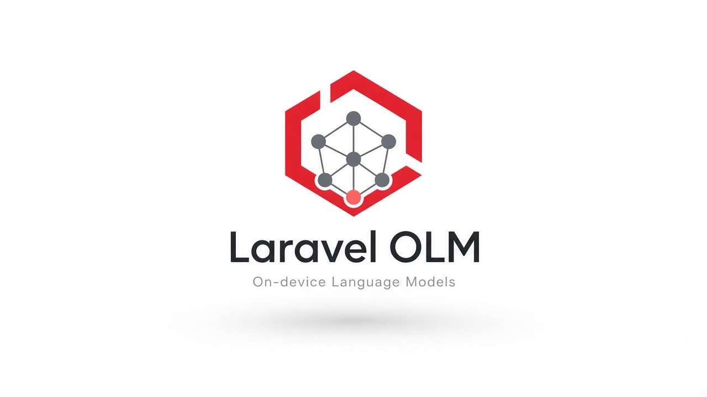

# Laravel OLM

<p align="center">
  
</p>

**OLM** (On-device Language Models) is a Laravel connector for local / on-device LLM backends: **MLX**, **Ollama**, **LM Studio**, **llama.cpp**, and **vLLM**.

Use one API in your Laravel app — switch backends with config.

## Features

- Unified chat, completions, embeddings, and streaming
- Driver pattern (`Olm::driver('mlx')`) like Laravel filesystem/mail
- OpenAI-compatible HTTP for MLX, LM Studio, llama.cpp, and vLLM
- Ollama native model list / pull / show
- Publishable config and facade helper

## Requirements

- PHP 8.1+ (8.3+ on Laravel 13)
- Laravel 9.x–13.x
- A running local inference server for the driver you choose

## Installation

```bash
composer require knackline/laravel-olm
```

Publish the config:

```bash
php artisan vendor:publish --provider="Knackline\Olm\Providers\OlmServiceProvider" --tag="olm-config"
```

## Configuration

`.env` examples:

```env
OLM_DRIVER=ollama

OLM_OLLAMA_BASE_URL=http://127.0.0.1:11434
OLM_OLLAMA_MODEL=llama3.2

OLM_MLX_BASE_URL=http://127.0.0.1:8080
OLM_MLX_MODEL=mlx-community/Mistral-7B-Instruct-v0.3-4bit

OLM_LMSTUDIO_BASE_URL=http://127.0.0.1:1234
OLM_LMSTUDIO_MODEL=local-model

OLM_LLAMACPP_BASE_URL=http://127.0.0.1:8080
OLM_VLLM_BASE_URL=http://127.0.0.1:8000
```

## Backend setup

### Ollama
Install [Ollama](https://ollama.com), then:
```bash
ollama pull llama3.2
```

### MLX (Apple Silicon)
```bash
pip install mlx-lm
mlx_lm.server --model mlx-community/Mistral-7B-Instruct-v0.3-4bit
```
Default listen address is typically `http://127.0.0.1:8080`.

### LM Studio
Start the local server in LM Studio (OpenAI-compatible API), usually `http://127.0.0.1:1234`.

### llama.cpp
Run `llama-server` with an OpenAI-compatible HTTP API, e.g. port `8080`.

### vLLM
```bash
vllm serve <model> --host 127.0.0.1 --port 8000
```

## Local development

`php artisan olm:serve` starts the configured default driver backend (`ollama serve`, `mlx_lm.server`, `llama-server`, or `vllm serve`). If the backend is already healthy, the command keeps the process alive so it can sit in a concurrent `dev` stack.

### Laravel 13+ (`composer run dev` / `php artisan dev`)

When `Illuminate\Foundation\DevCommands` is available, laravel-olm auto-registers process `olm` (`php artisan olm:serve`). Disable with:

```env
OLM_DEV=false
```

Or in your app:

```php
use Illuminate\Foundation\DevCommands;

DevCommands::except('olm');
```

LM Studio is not registered (no CLI start path) — start its server in the LM Studio app.

Override the shell command per driver with `serve` in config (or `OLM_*_SERVE` env vars).

### Older apps (`npx concurrently` in `composer.json`)

Append the OLM process to your existing `dev` script, for example:

```json
"dev": [
    "Composer\\Config::disableProcessTimeout",
    "npx concurrently -c \"#93c5fd,#c4b5fd,#fb7185,#fdba74,#86efac\" \"php artisan serve\" \"php artisan queue:listen --tries=1\" \"php artisan pail --timeout=0\" \"npm run dev\" \"php artisan olm:serve\" --names=server,queue,logs,vite,olm --kill-others"
]
```

## Usage

### Facade

```php
use Knackline\Olm\Facades\Olm;

$response = Olm::chat([
    ['role' => 'user', 'content' => 'Hello!'],
]);

echo $response->content;

// Another backend
$response = Olm::driver('mlx')->chat([
    ['role' => 'user', 'content' => 'Hello from MLX'],
], [
    'temperature' => 0.7,
]);
```

### Helper

```php
olm()->chat([
    ['role' => 'user', 'content' => 'Summarize this…'],
]);

olm('vllm')->embed('search query');
```

### Streaming

```php
foreach (Olm::streamChat([
    ['role' => 'user', 'content' => 'Write a haiku'],
]) as $token) {
    echo $token;
}
```

### Embeddings & completions

```php
$embedding = Olm::embed('hello world');
$vector = $embedding->first();

$completion = Olm::complete('Once upon a time');
```

### Models & Ollama pull

```php
$models = Olm::models();

// Ollama only
Olm::driver('ollama')->pull('llama3.2');
$info = Olm::driver('ollama')->show('llama3.2');
```

Calling `pull` / `show` on drivers that do not support them throws `UnsupportedOperationException`.

### Dependency injection

```php
use Knackline\Olm\OlmManager;

class ChatController
{
    public function __construct(protected OlmManager $olm)
    {
    }

    public function __invoke()
    {
        return $this->olm->chat([
            ['role' => 'user', 'content' => 'Hi'],
        ]);
    }
}
```

## Roadmap

- Fine-tuning helpers / job stubs
- Richer multimodal (vision / audio) support
- Optional integrations (Laravel AI, Prism, etc.)

## Testing

```bash
composer install
composer test
```

## Contributing

See [CONTRIBUTING.md](CONTRIBUTING.md).

## License

MIT — see [LICENSE](LICENSE).
